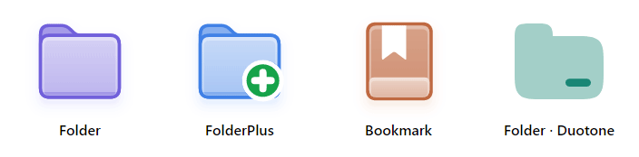
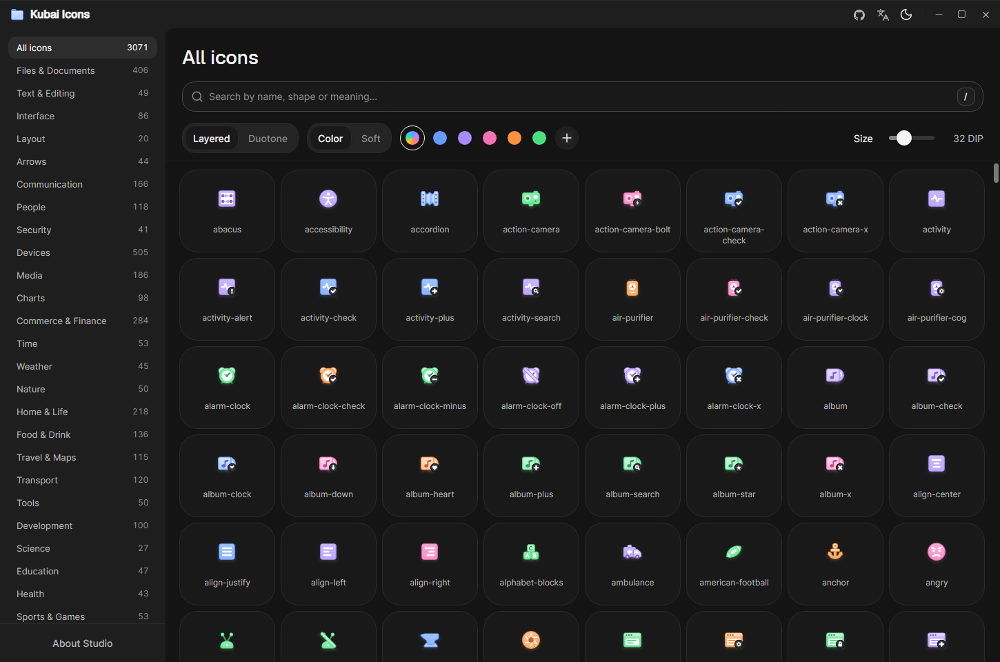

<div align="center">


<h1>KubaiIcons.Avalonia</h1>

<p><strong>High-performance, animated vector icons for Avalonia — precompiled to a compact binary format with on-demand loading and permanently stable enum IDs.</strong></p>

<p>English | <a href="README.zh-CN.md">简体中文</a></p>

</div>

An unofficial Avalonia port of [Kubai Icons](https://icons.kubai.design/) (`0.14.0`) by @Kubai087, maintained by @Sylinko.



Let a toolbar button open its folder icon on hover. Toggle a bookmark's saved state without losing it when the pointer leaves. Loop a loader while your app is busy. The `0.14.0` release
ships **3,573 icon variants** (**502 Duotone** and **3,071 Layered**: 967 base designs, 2,033 badge combinations, and 71 slash overlays) as native, custom-drawn
Avalonia controls targeting **.NET 8, .NET 10, and .NET 11** (`Avalonia >= 12.0.0`).

---

## Why KubaiIcons.Avalonia

### 1. High Performance by Design

- **Zero runtime SVG/JSON parsing**: All icons are compiled at build time into `KBI v1`, a compact internal binary format of pre-normalized path opcodes,
  coordinate encodings, animation tracks, and layer trees. The runtime library has **no SVG parser, no JavaScript engine, no `System.Text.Json` dependency, and
  no per-layer visual child controls**.
- **True on-demand loading & minimal cold start**: Reading `KubaiIconCatalog.All`, checking `Count`, setting properties, or even measuring an unrendered icon
  decodes **zero** artwork. Only the first `Render()` call opens and decodes the requested `.kbi` resource, builds native `StreamGeometry` once on the UI
  thread, and shares it across all instances.
- **Compact package & low memory footprint**: All **3,573** shipped icons are deduplicated into just **1,488 `.kbi` blocks** (502 Duotone + 968 Layered scenes +
  18 shared disc badges). Total uncompressed artwork is ~4.55 MiB, and the entire multi-targeted NuGet package (`.NET 8 / 10 / 11`) is **~4.40 MiB** (4,615,327
  B).
- **Zero idle overhead**: Static or hidden icons never schedule animation frames; repeat delays use a single `DispatcherTimer` wakeup rather than polling.

Measured across all 502 Duotone icons (uncached memory streams, median of 21 samples on .NET 8.0.34 / Avalonia 12.1.6 —
see [Binary Resources & Benchmarks](docs/binary-resources.md)):

| Metric (all 502 Duotone icons) | JSON baseline | `KBI v1` binary |                   Improvement |
|--------------------------------|--------------:|----------------:|------------------------------:|
| Embedded resource size         |     605,898 B |       273,972 B |             **54.8% smaller** |
| Data decode time               |      10.06 ms |         0.56 ms |  **~18× faster (94.4% less)** |
| Decode + native geometry prep  |      28.08 ms |         5.92 ms | **~4.7× faster (78.9% less)** |
| Managed memory allocated       |  12,300,768 B |     3,193,856 B |         **74.0% fewer bytes** |

> Normal applications only decode the subset of icons actually rendered on screen, keeping startup impact and working-set memory minimal.

### 2. Permanently Stable, `int`-Serializable Enum IDs

- **Append-only ID manifest**: Every icon in `KubaiIconKind`, `KubaiLayeredIconKind`, and `KubaiDuotoneIconKind` is backed by a frozen manifest ([
  `catalog/ids.props`](catalog/ids.props) and [`catalog/enum-baseline.json`](catalog/enum-baseline.json)).
- **Guaranteed compatibility**: Once published, an enum member's name and numeric `int` value. Future upstream updates
  only append new identities after the existing maximum.
- **Safe for persistence**: Store `(int)iconKind` directly in databases, JSON/binary configs, user preferences, or network protocols.
- **Cross-family ID alignment**: When an icon exists in both families (e.g., `Activity = 8`), `KubaiLayeredIconKind`, `KubaiDuotoneIconKind`, and
  `KubaiIconKind` share the exact same integer ID. Adding a missing style to an existing identity in a future release reuses its original ID in place.

---

## Quick Start

### Reference & Namespace

During preview, reference [`src/KubaiIcons.Avalonia/KubaiIcons.Avalonia.csproj`](src/KubaiIcons.Avalonia/KubaiIcons.Avalonia.csproj) (or pack it with
`dotnet pack`). Declare the namespace in AXAML—no `<StyleInclude>` or runtime asset initialization is required:

```xml
xmlns:i="using:KubaiIcons.Avalonia"
```

```xml
<i:KubaiLayeredIcon Kind="Folder" Size="24"/>
<i:KubaiDuotoneIcon Kind="Camera" Size="24"/>
<i:KubaiDuotoneIcon Kind="Loader"
                    IsPlaying="{Binding IsBusy}"
                    LoopMode="Repeat"/>
```

- `Size` defaults to `24` DIP and keeps artwork square inside rectangular bounds.
- Color follows the inherited solid `Foreground` brush by default; set `AccentColor` to override it independently.
- Standalone icons stay at rest by default. Set `IsEngaged` with a style or binding to enter the action pose.

### Engage from a Parent Button or Style

Add this style to the window, then apply `icon-host` to any button that should animate its icon. Hover anywhere on the button or focus it with the keyboard to open the folder:

```xml
<Window.Styles>
  <Style Selector="Button.icon-host:pointerover i|KubaiLayeredIcon,
                   Button.icon-host:focus-visible i|KubaiLayeredIcon">
    <Setter Property="IsEngaged" Value="True"/>
  </Style>
</Window.Styles>

<Button Classes="icon-host" AutomationProperties.Name="New folder">
  <i:KubaiLayeredIcon Kind="FolderPlus"/>
</Button>
```

### Persistent State (`IsActive`), Palettes, and Badges

- **`IsEngaged`**: Holds the authored action pose; clearing it reverses cleanly from the current on-screen pose. Local values and bindings override hover styles
  automatically.
- **`IsActive`**: Controls persistent state on supporting artwork (such as the saved ribbon and star on Layered `Bookmark` and its badge combinations),
  independent of hover/playback.
- **`ColorVariant`**: Switches Layered artwork between `Color` (default) and `Soft` palettes.
- **`IsSemanticBadgeEnabled` / `BadgeColor`**: Badged icons default to neutral ink; set `IsSemanticBadgeEnabled="True"` for the artist's semantic badge tone
  (e.g., amber on `FolderAlert`) or `BadgeColor` to specify any color.

```xml
<i:KubaiLayeredIcon Kind="FolderAlert" IsSemanticBadgeEnabled="True"/>
<i:KubaiLayeredIcon Kind="Bookmark" IsActive="{Binding IsSaved}"/>
```

### Playback Control (XAML & C#)

```xml
<i:KubaiLayeredIcon Kind="Folder"
                    IsPlaying="{Binding IsBusy}"
                    LoopMode="Repeat"
                    SpeedRatio="1.2"
                    RepeatDelay="0:0:0.3"/>
```

- **`IsPlaying`**: A `false` → `true` transition starts playback; `false` stops it. Completion in `Once` mode never mutates your binding.
- **`LoopMode`**: `Once` (default) plays the authored entrance + return cycle; `Repeat` loops until stopped (switching back to `Once` finishes the current
  cycle).
- **`SpeedRatio`**: Positive finite multiplier (default `1`), adjustable live without restarting motion.
- **`RepeatDelay`**: Wall-clock rest interval between cycles (unaffected by `SpeedRatio`).
- **`IsAnimating`**: Read-only status reporting whether a transition is actively advancing frames (`false` during `RepeatDelay` gaps and at rest).

Full C# control shares the exact same playback engine:

```csharp
var icon = new KubaiLayeredIcon
{
    Kind = KubaiLayeredIconKind.Bookmark,
    Size = 32,
    AccentColor = Color.Parse("#7160DB"),
};

icon.IsActive = true;    // Toggle persistent saved state independently of motion
icon.IsEngaged = true;   // Move to and hold the action pose

icon.LoopMode = LoopMode.Repeat;
icon.IsPlaying = true;   // Start playback
icon.SpeedRatio = 2;     // Adjust live mid-motion
icon.IsPlaying = false;  // Stop and settle back to IsEngaged

icon.Play();             // Explicitly retrigger without mutating IsPlaying
icon.Stop();             // Cancel without mutating IsPlaying or its binding
```

> To hand control back to styles after assigning a local value in C#, call `icon.ClearValue(KubaiIconBase.IsEngagedProperty)`.

### Reduced Motion & Power Efficiency

Set `IsAnimationEnabled="False"` on an icon or any ancestor container (it is an inherited property) to apply poses and saved states immediately with zero
animation frames. Windows client-area animation preferences are respected automatically. Hidden, disabled, detached, or zero-sized icons stop requesting frames
until visible and available again.

---

## Catalog & Family Selection

Use strongly typed controls (`KubaiLayeredIcon` / `KubaiDuotoneIcon`) when the family is known at compile time so IntelliSense only offers supported icons. Use
`KubaiIcon` with `Kind` (`KubaiIconKind`) + `IconStyle` (`KubaiIconStyle`) when selecting styles dynamically at runtime.

```csharp
// Lightweight metadata inspection — decodes zero artwork blocks
var duotoneIcons = KubaiIconCatalog.All.Where(i => i.HasDuotone);
var info = KubaiIconCatalog.Get(KubaiIconKind.Bookmark);
bool canSave = info?.SupportsActiveState(KubaiIconStyle.Layered) == true;

// Safe cross-family ID conversion
if (KubaiLayeredIconKind.Activity.TryToDuotone(out var duotoneKind))
{
    // Both families share Activity = 8
}
```

- `KubaiIconCatalog.All.Count` returns `3074` without even initializing the metadata table.
- `KubaiIconCatalog.Get(kind)` performs direct `O(1)` slot indexing without runtime sorting or dictionary construction.
- Always serialize `(int)kind` rather than an index into `KubaiIconCatalog.All`.

---

## Try Icon Studio

With the .NET 11 SDK specified in [`global.json`](global.json), launch the interactive gallery and code generator from the repository root:

```sh
dotnet run --project samples/IconStudio
```



- **Bilingual Search & UI**: Switch between **English** and **简体中文**; search all 3,573 variants across 26 categories by English name, Chinese label, C# enum
  name, shape, or meaning (`/` or `Ctrl/Cmd+K`).
- **Live Inspector & Snippet Copy**: Adjust size (`16–64` DIP), `Color`/`Soft` palette, custom accent (`+`) or deterministic `Mixed` colors, `Hold pose`,
  `Active`, `LoopMode`, `SpeedRatio`, and `RepeatDelay`, then copy ready-to-paste **AXAML** or **C#**.
- **Virtualized & Lazy**: Searching filters metadata only; only visible gallery tiles decode `.kbi` artwork, and closing the inspector detaches its player.

Built with [TKCode.Arc](https://github.com/AIDotNet/TKCode.Arc) `1.3.0` (on Avalonia `12.1.6`). The core `KubaiIcons.Avalonia` library has **no Arc dependency**
and retains its **Avalonia 12.0.0** compatibility floor.

---

## Testing & Verification

Run the test suite:

```sh
dotnet test KubaiIcons.Avalonia.slnx -c Release
```

The test suite verifies enum value and declaration-order immutability against [
`tests/KubaiIcons.Tests/Contracts/first-release.json`](tests/KubaiIcons.Tests/Contracts/first-release.json), cross-culture deterministic imports, lazy block
decoding via the `KubaiIcons-Avalonia` `EventSource`, playback lifecycles, all 502 Duotone poses and upstream motion samples, and Studio UI/clipboard contracts.

### Further Documentation

- [NuGet Package Overview](docs/nuget.md) — concise package README shipped inside the `.nupkg`.
- [Binary Resources & Benchmarks](docs/binary-resources.md) — `KBI v1` format layout, path encoding, and measured decode/allocation numbers.
- [Porting Architecture](docs/porting.md) — rendering pipeline, playback state machine, and lazy loading contracts.
- [Importing & Compatibility](docs/importing.md) — CI-verified importer workflow, upstream sync, and visual regression comparison.
- [Icon Studio Design Notes](docs/studio.md) — Studio UX, localization, and `TKCode.Arc` integration details.

---

## License

- **Port & Runtime Library**: [MIT License](LICENSE), copyright © 2026 Sylinko.
- **Original Artwork & Motion Routines**: Adapted from [kubai-icons@0.14.0](https://github.com/kubai087/kubai-icons/tree/kubai-icons%400.14.0), copyright © 2026
  Kubai087 and contributors under the [original MIT license](licenses/LICENSE-ICONS). Both notices ship in the NuGet package
  (see [source credits](licenses/README.md)).
- **Icon Studio**: Uses MIT-licensed `TKCode.Arc` and SIL OFL fonts (`Inter`, `Geist`, `Geist Mono`); notices are kept under [
  `licenses/studio`](licenses/studio/README.md) and are excluded from the library NuGet package.
