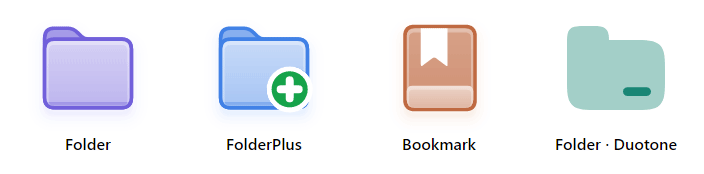
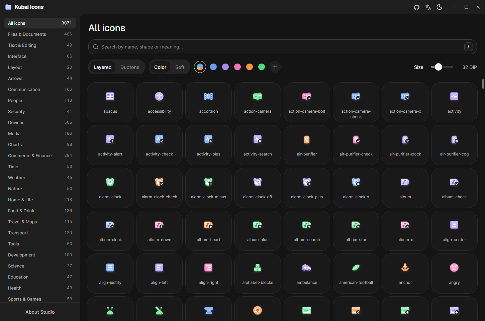

<div align="center">


<h1>KubaiIcons.Avalonia</h1>

<p><strong>专为 Avalonia 打造的高性能动态矢量图标库 —— 全量预编译为紧凑二进制格式、按需懒加载、枚举 ID 永久稳定。</strong></p>

<p><a href="README.md">English</a> | 简体中文</p>

</div>

[Kubai Icons](https://icons.kubai.design/)（原作者 @Kubai087）的非官方 Avalonia 原生移植版，由 @Sylinko 维护。



可以让工具栏按钮在悬停时展开文件夹，切换书签收藏状态后移开指针也不会丢失姿态，在应用繁忙时循环播放加载动效。

图标库提供 **3,000+ 个 Layered 多层图标变体**和 **500+ 个 Duotone 双色图标变体**，由 Avalonia 原生绘制，支持 **.NET 8 / .NET 10 / .NET 11**（`Avalonia >= 12.0.0`）。

---

## 核心优势

### 1. 极致性能：预编译二进制 + 按需加载

- **运行时零 SVG / JSON 解析**：所有图标均在构建期预编译为内部专属二进制格式 `KBI v1`（包含归一化后的路径指令、无损定点数/浮点坐标、动画轨道与图层树）。运行时库
  **不解析任何 SVG 文本、不执行 JavaScript、无 `System.Text.Json` 依赖，也不为图层创建额外子控件树**。
- **真正按需解码，冷启动极轻**：访问 `KubaiIconCatalog.All`、读取 `Count`、设置控件属性乃至仅测量未渲染图标时，均**不会解码任何图形数据**。只有在控件首次执行
  `Render()` 时，才会读取对应的 `.kbi` 嵌入式资源并在 UI 线程一次性生成原生 `StreamGeometry`，随后在同类型实例间全局共享复用。
- **共享图形资源**：Layered 变体复用底图、徽章或斜线，不必为每种组合单独打包一份图形。
- **静默态零帧开销**：静止、隐藏、禁用或脱离可视树的图标不请求任何帧回调；循环播放的间隔等待仅使用单次 `DispatcherTimer` 唤醒，杜绝轮询。

以下数据测自 `0.14.0` 的全部 502 个 Duotone 图标（基于 Windows x64 / .NET 8.0.34 / Avalonia 12.1.6，禁用分层编译、绕过图形缓存、内存流直读，取 3 次预热后 21
轮采样中位数，详见 [二进制资源与基准测试](docs/binary-resources.md)）：

| 指标（全部 502 个 Duotone 图标） |    JSON 基线 | `KBI v1` 二进制 |                            提升幅度 |
|----------------------------------|-------------:|----------------:|------------------------------------:|
| 嵌入资源体积                     |    605,898 B |       273,972 B |                  **体积缩减 54.8%** |
| 数据解码耗时                     |     10.06 ms |         0.56 ms |  **提速约 18 倍（耗时减少 94.4%）** |
| 解码 + 原生几何构建总耗时        |     28.08 ms |         5.92 ms | **提速约 4.7 倍（耗时减少 78.9%）** |
| 托管内存分配总量                 | 12,300,768 B |     3,193,856 B |              **内存分配减少 74.0%** |

> 在实际业务应用中，程序只会按需解码屏幕上真正渲染到的那部分图标，冷启动延迟与常驻托管内存占用表现更为出色。

### 2. 枚举稳定：一经发布永久不变，放心按 `int` 序列化

- **只增不改的 ID 清单机制**：`KubaiIconKind`、`KubaiLayeredIconKind` 与 `KubaiDuotoneIconKind` 均由冻结清单 [`catalog/ids.props`](catalog/ids.props) 与 [
  `catalog/enum-baseline.json`](catalog/enum-baseline.json) 严格驱动，并受 CI 基线检查与自动化测试保护。
- **永不重排、永不复用**：枚举成员的名称与整型值一经发布即永久锁定。后续同步上游新图标时，**只会在现有最大编号之后追加新枚举值**，绝不修改或回收已有成员的数值。
- **可直接作为 `int` 持久化**：无论是存入数据库、JSON / Protobuf 配置文件，还是用于用户自定义模板与网络传输，都可以直接强转为 `int` 安全序列化。
- **跨风格同源同号**：同一图标在不同风格中共享同一个整数 ID（例如 `Activity = 8` 在 `KubaiLayeredIconKind` 和 `KubaiDuotoneIconKind` 中同为 `8`
  ）。若后续版本为已有图标补齐第二种风格，也会原地复用其原有 ID。

---

## 快速上手

### 引用与命名空间

预览阶段可直接引用 [`src/KubaiIcons.Avalonia/KubaiIcons.Avalonia.csproj`](src/KubaiIcons.Avalonia/KubaiIcons.Avalonia.csproj)（或执行 `dotnet pack` 打包本地引用）。在
AXAML 中声明命名空间即可使用，**无需引入任何 StyleInclude 或初始化资源**：

```xml
xmlns:i="using:KubaiIcons.Avalonia"
```

```xml
<i:KubaiLayeredIcon Kind="Folder" Size="24"/>
<i:KubaiDuotoneIcon Kind="Camera" Size="24"/>
<i:KubaiDuotoneIcon Kind="Loader"
                    IsPlaying="{Binding IsBusy}"
                    LoopMode="Repeat"/>
```

- `Size` 默认为 `24` DIP，在非正方形容器内会自动保持正方形居中缩放。
- 颜色默认继承父级的纯色 `Foreground`；也可单独指定 `AccentColor` 覆盖配色。
- 独立图标默认静止。通过宿主样式或绑定设置 `IsEngaged`，图标才会进入动作姿态。

### 让外层按钮联动图标动效

把样式放在窗口中，再给需要动效的按钮加上 `icon-host`。悬停在按钮的任意位置，或用键盘聚焦按钮，都会展开文件夹：

```xml
<Window.Styles>
  <Style Selector="Button.icon-host:pointerover i|KubaiLayeredIcon,
                   Button.icon-host:focus-visible i|KubaiLayeredIcon">
    <Setter Property="IsEngaged" Value="True"/>
  </Style>
</Window.Styles>

<Button Classes="icon-host" AutomationProperties.Name="新建文件夹">
  <i:KubaiLayeredIcon Kind="FolderPlus"/>
</Button>
```

### 持久状态（`IsActive`）、调色板与徽章

- **`IsEngaged`**：控制是否保持展开/动作姿态；取消后从当前屏幕姿态平滑回落。本地赋值或绑定优先于样式中的 setter。
- **`IsActive`**：用于支持持久状态的图标（如 Layered `Bookmark` 及其徽章变体的已收藏丝带与星标），与悬停/播放状态相互独立。
- **`ColorVariant`**：在 Layered 风格下切换 `Color`（默认鲜明色彩）与 `Soft`（柔和配色）调色板。
- **`IsSemanticBadgeEnabled` / `BadgeColor`**：带徽章的图标默认使用中性配色；设置 `IsSemanticBadgeEnabled="True"` 可启用作者预设的语义色（如 `FolderAlert`
  的琥珀警告色），也可通过 `BadgeColor` 自定义任意徽章颜色。

```xml
<i:KubaiLayeredIcon Kind="FolderAlert" IsSemanticBadgeEnabled="True"/>
<i:KubaiLayeredIcon Kind="Bookmark" IsActive="{Binding IsSaved}"/>
```

### 播放控制（XAML 与 C#）

```xml
<i:KubaiLayeredIcon Kind="Folder"
                    IsPlaying="{Binding IsBusy}"
                    LoopMode="Repeat"
                    SpeedRatio="1.2"
                    RepeatDelay="0:0:0.3"/>
```

- **`IsPlaying`**：`false` → `true` 的上升沿触发播放，`false` 停止。`Once` 模式播放完毕后不会反写你的绑定属性。
- **`LoopMode`**：默认为 `Once`（执行完整进场+回落周期）；设为 `Repeat` 将持续循环直至停止（运行中切回 `Once` 会平稳完成当前周期）。
- **`SpeedRatio`**：正有限倍速（默认 `1`），支持在动画进行中实时调节而不打断当前进度。
- **`RepeatDelay`**：循环周期之间的墙钟休止间隔（不受 `SpeedRatio` 缩放影响）。
- **`IsAnimating`**：只读状态属性，反映当前是否正在推进动画帧（间隔等待与静止时均为 `false`）。

C# 代码与 XAML 共享同一套底层播放器：

```csharp
var icon = new KubaiLayeredIcon
{
    Kind = KubaiLayeredIconKind.Bookmark,
    Size = 32,
    AccentColor = Color.Parse("#7160DB"),
};

icon.IsActive = true;    // 独立设置持久收藏状态
icon.IsEngaged = true;   // 切换并保持动作姿态

icon.LoopMode = LoopMode.Repeat;
icon.IsPlaying = true;   // 启动播放请求
icon.SpeedRatio = 2;     // 运行中实时变速
icon.IsPlaying = false;  // 停止并平稳回到 IsEngaged 目标姿态

icon.Play();             // 显式重播（不修改 IsPlaying 及其绑定）
icon.Stop();             // 取消播放（不修改 IsPlaying 及其绑定）
```

> 若在 C# 中赋值后希望把控制权交还给样式系统，调用 `icon.ClearValue(KubaiIconBase.IsEngagedProperty)` 即可。

### 减弱动态效果与节能机制

在图标或其任意父级容器上设置 `IsAnimationEnabled="False"`（支持属性继承），即可立即应用目标姿态与持久状态，不产生任何动画帧。Windows
系统的客户端动画偏好会被自动遵循；不可见、禁用、脱离可视树或尺寸为零的图标不会继续请求帧调度。

---

## 目录查询与动态风格切换

在编译期已明确图标风格时，优先使用强类型控件 `KubaiLayeredIcon` 或 `KubaiDuotoneIcon`，使 `Kind` 仅提示该风格实际拥有的成员；若需在运行时动态切换风格，可使用通用控件
`KubaiIcon` 配合 `Kind`（`KubaiIconKind`）和 `IconStyle`（`KubaiIconStyle`）。

```csharp
// 轻量级元数据查询 —— 不触发任何图形二进制解码
var duotoneIcons = KubaiIconCatalog.All.Where(i => i.HasDuotone);
var info = KubaiIconCatalog.Get(KubaiIconKind.Bookmark);
bool canSave = info?.SupportsActiveState(KubaiIconStyle.Layered) == true;

// 跨风格安全转换
if (KubaiLayeredIconKind.Activity.TryToDuotone(out var duotoneKind))
{
    // 两种风格下 Activity 共享同一个整数 ID：8
}
```

- `KubaiIconCatalog.All.Count` 返回不重复的图标名称总数，不会初始化元数据表。
- `KubaiIconCatalog.Get(kind)` 基于永久 ID 直接执行 `O(1)` 槽位索引，无运行时排序或字典构建开销。
- 如需持久化保存图标标识，请始终序列化 `(int)kind`，而不要保存 `KubaiIconCatalog.All` 的索引位置。

---

## 运行 Icon Studio 交互式图库

使用 [`global.json`](global.json) 指定的 .NET 11 SDK，在仓库根目录运行：

```sh
dotnet run --project samples/IconStudio
```



- **中英双语界面与搜索**：一键切换 **English** / **简体中文**，按分类浏览，或用英文名、中文标签、C# 枚举名、图形特征或语义搜索（快捷键 `/` 或 `Ctrl/Cmd+K`）。
- **实时检视与代码复制**：支持 `16–64` DIP 尺寸滑块、`Color`/`Soft` 调色板、自定义取色（`+`）或稳定随机色（`Mixed`）、`Hold pose`、`Active` 以及循环/倍速设置，随时一键复制
  **AXAML** 或 **C#** 示例。
- **虚拟化与按需解码**：列表采用行级虚拟化，搜索仅检索元数据不加载任何图形，仅当前可视区域内的图块会触发 `.kbi` 懒加载。

Studio 基于 [TKCode.Arc](https://github.com/AIDotNet/TKCode.Arc) `1.3.0`（Avalonia `12.2.0`）构建；核心图标库 `KubaiIcons.Avalonia` **完全不依赖 Arc**，保持
**Avalonia 12.0.0** 最低兼容版本。

---

## 测试与更多文档

在仓库根目录运行核心库和导入器测试，无需构建 Studio：

```sh
dotnet test tests/KubaiIcons.Tests -c Release --filter "TestCategory!=Artwork"
```

日常测试覆盖枚举 ID 稳定性、已有图标补齐另一种风格、确定性导入、按需解码和播放行为。像素与动画采样需要对照时，再运行[本地图稿验证](docs/importing.md#local-artwork-comparisons)。

### 延伸文档（英文）

- [NuGet 包说明](docs/nuget.md) — 随 `.nupkg` 一并打包的精简使用说明。
- [二进制资源格式与性能基准](docs/binary-resources.md) — `KBI v1` 格式规范、路径编码及完整性能对比数据。
- [移植架构说明](docs/porting.md) — 渲染管线、统一动画状态机与懒加载契约。
- [导入器与兼容性校验](docs/importing.md) — CI 自动化导入、上游版本同步及视觉像素回归指南。
- [Icon Studio 设计笔记](docs/studio.md) — Studio 交互设计、本地化及 `TKCode.Arc` 集成细节。

---

## 开源许可

- **移植与运行时库**：采用 [MIT License](LICENSE)，Copyright © 2026 Sylinko。
- **原始图标与动效算法**：改编自 [Kubai Icons](https://github.com/kubai087/kubai-icons)，Copyright © 2026 Kubai087
  及贡献者，遵循 [原始 MIT 许可](licenses/LICENSE-ICONS)。两份声明均包含在 NuGet 包中（详见 [致谢与来源说明](licenses/README.md)）。
- **Icon Studio 示例**：使用了 MIT 许可的 `TKCode.Arc` 与 SIL OFL 字体（`Inter`、`Geist`、`Geist Mono`），相关声明位于 [`licenses/studio`](licenses/studio/README.md)
  ，不会打包进入图标库 NuGet 包。
